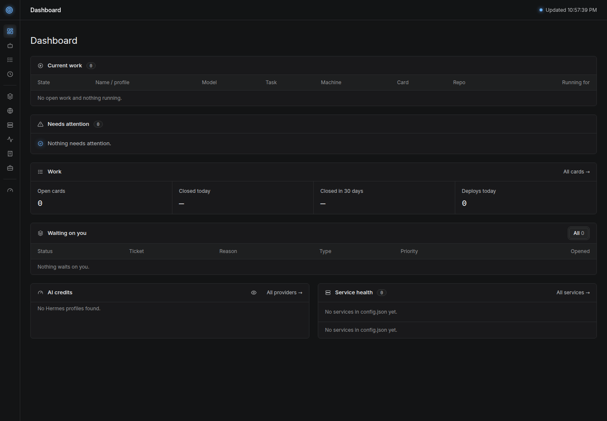

# Collector

One local page that shows every cron job and every agent run on all your machines, live.

It is for one person running several agents, scheduled jobs and websites: a laptop and a VPS or two, a handful of
repos, coding agents that build and review work in git worktrees. Collector reads all of it and puts it on one page
in your browser — what is running now, what failed, what waits on you, what it costs.



No agent crew yet: start with [Hermes Agent](https://github.com/NousResearch/hermes-agent) and its cron jobs, which
is what Collector is built to read. The agent stack that hands our own agents their cards (the board, the lanes, the
scripts that run them) is ours and is not published yet.

## Install

One command, on macOS and Linux:

```bash
curl -fsSL https://raw.githubusercontent.com/dividendsolo/collector/main/install.sh | sh
```

It clones Collector into `~/collector`, installs [Bun](https://bun.sh) when you do not have it, installs the app's
packages, builds it and starts it on http://127.0.0.1:4000. Another folder or port: `COLLECTOR_DIR` and
`COLLECTOR_PORT`, or `install.sh --help`. When it installs Bun, Bun goes into `~/.bun` and its installer adds itself
to your `PATH` in your shell's startup file. Apart from that it writes nothing outside the Collector folder (only
`node_modules` and `.next` inside it): no settings file, no `.env`, and nothing at all on the machines it reads.

In a checkout you already have, the same script is in the folder:

```bash
./install.sh              # install, build and start it here
./install.sh --port 4001  # on another port
./install.sh --help       # every option
```

Then open http://127.0.0.1:4000. With no settings at all it shows what it finds on its own: the Hermes cron jobs,
the launchd jobs and the running coding-agent sessions of the machine it runs on.

Settings are optional and live in `config.json`: [SETUP.md](SETUP.md) holds one prompt for your coding agent
(Claude Code, Codex, Hermes) that reads your machine read-only, writes the file from what it finds and reports what
it skipped, or `cp config.example.json config.json` and edit it by hand. [Settings](#settings) below covers the two
keys worth knowing on the first day; [Configure it](#configure-it) has all of them.

`bun dev` runs it with hot reload while you change the code. `COLLECTOR_CONFIG` points it at a config file somewhere
else. The page reads machines and jobs every 15 seconds and the other panels once a minute. The board comes faster:
the server reads it every 10 seconds and pushes each change to the page (server-sent events), so a lane change shows
within about 10 seconds. No page waits on a slow reader: each panel shows skeleton rows, then fills. After a rebuild
and a restart, an open page reloads itself.

To start it at login on macOS, copy `launchd/com.example.collector.plist` to `~/Library/LaunchAgents/`, set the
path to your Collector folder, and run `launchctl bootstrap gui/$(id -u) ~/Library/LaunchAgents/com.example.collector.plist`.
Then `launchd/com.example.collector-rebuild.plist` the same way: every five minutes it checks whether the build the
page serves is behind `main` and, when it is, pulls it and builds into `.next-rebuild` beside the served `.next`. A
finished build shows in the page's top bar as an **Update** button, and the click is what swaps it in and restarts,
so a merge never restarts the server by itself. A failed build is logged (`[rebuild] build failed`) and the served
`.next` is left as it was. `bun scripts/rebuild-if-stale.ts --check` is the read-only form of that check. Once a
checkout is the one being served, leave it alone: `install.sh` builds into the `.next` that server is reading, so
updates go through the page's button.

## Requirements

- [Bun](https://bun.sh) 1.4 or later, which `install.sh` installs when it is missing. Collector is a Next.js app
  (TypeScript); `bun install` gets the rest.
- Python 3.9 or later, standard library only, on this machine and on each remote machine: `collect.py` reads each one.
- SSH access (key-based) to each remote machine, with `python3` on it.
- The [GitHub CLI](https://cli.github.com) (`gh`), signed in with the `user` scope (`gh auth refresh -h github.com -s user`), for the board, the API limit, Actions minutes and dollars (the billing usage summary of the signed-in account; without that scope GitHub answers 404, the panel says it could not read them, and set `actions_minutes` in `config.json` if your plan is not read right), and the Projects page.
- Optional: Docker, for verify runs in the Running now table.

## What it shows

The Dashboard answers these questions at a glance:

1. **Needs attention:** which job failed, which script starts itself in a loop, which host cannot pass a repo's
   checks, which GitHub limit is nearly gone (the API limits, and GitHub Actions minutes at 90% of what the plan
   includes; that row carries the dollars billed this month on its right). The APIs page shows the same bar for Jog's
   runner minutes beside them, and the Dashboard shows the Jog bar in its own panel.
2. **Running now:** which agent or script works on which card, in which repo, on which machine, and for how long. Hover a card number to read what the card is for.
   A build turns amber after 30 minutes and red after an hour.
   A process left in a card's worktree — a test server nothing stopped — is its own row: `leftover`, the program it
   runs with the port it listens on (`bun start :4123`), and how long it has been there. It is never named after the
   work script, and the work script's own rows say the step it is on (preparing, verifying, merging), never `building`.
   The table also shows the model each agent calls now (a fallback model shows too).
3. **Service health:** whether each of your sites is online, slow (over 3 s), or down, checked once a minute.
4. **AI credits:** one line per AI provider your Hermes profiles use (each profile's `config.yaml`), read from the
   provider. Plans (subscriptions with usage windows) show bars like the GitHub limit: the Claude subscription
   through Claude Code's own login in the macOS keychain (read only, never renewed), the MiniMax coding plan through
   `MINIMAX_API_KEY` in `~/.hermes/.env`, and Grok as a login check (xAI has no usage API for subscriptions).
   Pay-as-you-go credits (Nous, through Hermes's portal login) show the balance. Under $5, under 10% left, or a
   failed login goes to Needs attention. The Subscriptions page has both panels on top, then your subscriptions, with annual
   charges counted as a twelfth a month; every eye button blurs every amount, so you can share the screen.
5. **Work:** open cards on the board, cards closed as done today and in 30 days, deploys today per repo (production
   GitHub deployments, or successful CI jobs named "deploy" on pushes to main). The Waiting on you panel lists every ticket in the waiting statuses (`statuses.waiting`, the old `tickets.each`), with one filter button per status; its red
   count, and a red dot on Work in the sidebar, are the P0s.
6. **Cron jobs:** every scheduled job on every machine — Hermes's own, launchd's on a Mac, this user's plain
   `crontab` lines and the systemd timers on Linux — with its status, machine, schedule, last run, and last result.
   A crontab line keeps no run history, so its row says so instead of reading as a failure; a systemd timer shows the
   last exit of the service it starts, so a run that failed shows as failed.
   Each job opens its own page: its setup (model, output, size in characters or lines and tokens), its schedule,
   its run counts, the agent's full prompt or the script's source, the last error, and its last 10 runs.

The **Work** page shows your GitHub contribution heat map, then lists every open card on the board (the `tickets` key's `all` lanes): repo, card, title, lane,
priority, labels, and how many days ago it was opened: P0 first, then P1, P2, and no priority; inside one priority, in lane order, then oldest first.

The **Agents** page shows Running now, then every Hermes profile on every machine, A to Z: a short note, the type,
the model, the machine, and how many cron jobs the profile runs. Each agent opens its own page with its model,
provider, last session, rules summary, and the cron jobs it runs.

The **Projects** page shows the repos you choose: product name, repo, type, status, hosting, live URL, and health. Hover a row to read what the project does (the repo description). Collector itself shows its localhost address as the live URL.
Each project opens its own page with the last push, open issues and PRs, CI on the default branch, the card an
agent works on now, and the tech stack read from the repo's `package.json` and `Gemfile`. Hosting comes from the live site's headers, the last GitHub deployment, or a host file in the
repo (`.kamal`, `config/deploy.yml`, `fly.toml`, `vercel.json`, and others).

Each project page also shows a Stats card: monthly spend (subscriptions tagged with the project), MRR and ARR and
total revenue (from the project's payment providers, Stripe and Polar), and revenue and visitors over 30 days
(from DataFast). The Payment keys page (`#/keys`) shows how to make each read-only key and whether it works.

The **Network** page shows every port each machine listens on — TCP and UDP, with the process that owns it — and
marks the ones anyone can reach: a socket bound to `0.0.0.0`, `::` or a public address whose port is not on that
machine's allow list is red, a socket only this machine or its tailnet can reach is plain, and so is a port you put
on the allow list. The same read says whether sshd takes password logins or root login. A machine with ports open
to everyone gets one error row in Needs attention naming them, so one busy machine cannot bury every other warning.

It reads only. It never changes a job or a card on its own: the two buttons you click yourself (Start Tailscale,
Start Hermes) act on the machine Collector runs on. Its other write is your repo choice, saved to `config.json`.

## Settings

Every key in `config.json` is optional, and Collector runs without the file at all. Two are worth knowing on the
first day, since they change what the page reads rather than adding a panel to it:

- **`statuses`** — which card statuses Collector reads. `waiting` is the Waiting on you list: only those lanes, in
  the order you write them. `working` is the statuses that say a machine or a session holds the card (a card there
  with no run behind it shows how old the data is instead of its status). `done` is the statuses that mean finished:
  those cards are not open work and not a wait. Left out, it reads the four waiting lanes of the agent stack, the two
  working ones and `closed`. The Card flow page lists the sets the page is reading.

  ```json
  {
    "statuses": {
      "waiting": ["blocked-on-me", "review-me"],
      "working": ["in-progress"],
      "done": ["closed"]
    }
  }
  ```

- **`watch`** — the agents and jobs of your own you want a warning about, on top of the ones Collector reads by
  itself (Hermes's jobs, launchd's, `crontab -l`'s lines, the systemd timers, the Hermes gateway and its ticker, and
  the running Claude Code and Codex sessions). One entry names one thing and the signal that says how it is doing:

  ```json
  {
    "watch": [
      { "name": "Nightly backup", "launchd": "com.example.backup" },
      { "name": "Sync", "log": "~/.logs/sync.log", "fail_on": "error", "idle_after": 3600 },
      { "name": "The crew", "heartbeat": "~/.work/crew.beat", "idle_after": 900 },
      { "name": "My agent", "process": "my-agent.py" },
      { "name": "My Claude Code session", "session": "claude" }
    ]
  }
  ```

  `process` (text its command line carries while it runs), `session` (`claude` or `codex`, a running coding-agent
  session), `launchd` (a label: its last exit code says whether its last run worked), `log` (a file: its last line
  against `fail_on`, and how long since anything was written), or `heartbeat` (a file the agent writes as it goes,
  holding an epoch second or nothing), with `idle_after` seconds without a write (default 900). `machine` names the
  machine it lives on, by the name in `machines`; left out, the machine Collector runs on. A failure is an error in
  Needs attention, and idle too long a warning.

Every other key is in [Configure it](#configure-it) below, and `bun run check:config` names any key Collector would
never read, so a typo cannot hide.

## Configure it

`config.json` is yours and stays out of git. Every key is optional.

| Key | What it does |
|---|---|
| `machines` | The machines to read, in table order: `{"name": "laptop"}` for this machine, `{"name": "vps", "ssh": "user@host"}` for one over SSH. |
| `jobs` | One plain-words line per job name, shown in the "What it does" column. |
| `launchd_prefixes` | macOS: launchd jobs whose label starts with one of these show in the table. |
| `ok_exits` | launchd exit codes that mean success for one job: `{"<label>": {"<code>": "<text>"}}`. |
| `work_script` | A script that picks up cards and starts agents. `jobs` are the cron jobs that start it, `log` is its log (each start writes `=== tick <time> ===`), `name` is the name shown when it runs a step itself, `steps` is an optional folder where it writes what it does on each card now (one JSON file per card: `repo`, `card`, `step`, `since`, `pid`; the step shows on the script's own row, and a process in a card worktree with no step file and no verify run is a `leftover`, named after the program it runs, never after the script), and `max_starts_60s` (default 5) is the loop alarm. |
| `watch` | The agents and jobs of your own you want a warning about, on top of the ones Collector reads by itself (Hermes's jobs, launchd's, `crontab -l`'s, the systemd timers, the Hermes gateway and its ticker, and the running Claude Code and Codex sessions): `[{"name": "Nightly backup", "launchd": "com.example.backup"}, {"name": "My Claude session", "session": "claude"}]`. One entry names one thing and the signal that says how it is doing: `process` (text its command line carries while it runs), `session` (`claude` or `codex`, a running coding-agent session), `launchd` (a label; its last exit code says whether its last run worked, and an `ok_exits` entry for that label still means success), `log` (a file: its last line against `fail_on`, and how long since it was written), or `heartbeat` (a file it writes as it goes, holding an epoch second or nothing) with `idle_after` seconds without a write (default 900). `machine` names the machine it lives on, by the name in `machines`; left out, the machine Collector runs on, since a process, a launchd label and a file each belong to one machine. A failure is an error in Needs attention and idle too long a warning; a `process` or a `session` that is not running reads as idle right away, and a file that was never written as idle too. Checked every 15 seconds with the machines. |
| `network` | The ports a machine may have open to everyone: `{"allow": [22, 80, 443]}`. Every other port a machine listens on beyond `127.0.0.1` or its tailnet address is red on the Network page and an error in Needs attention, so this list is how you say a port is meant to be public; left out it reads 22, 80 and 443. A port you mean to be public goes here, and a dev server you meant to stop does not. |
| `verify_label` | The Docker label prefix your verify tool puts on its containers (`<prefix>.run`, `<prefix>.commit`). A running verify shows as the card's current task. |
| `services` | Sites to check once a minute: `[{"name": "My app", "url": "https://example.com"}]`. A project whose repo name matches a service name shows that service's status. |
| `vendors` | The outside services you depend on, by their public status page: `[{"name": "GitHub", "url": "https://www.githubstatus.com"}]`. The Collector reads the page's feed by its shape: Statuspage (`/api/v2/summary.json`), Datadog status pages (`/config.json`), Better Stack (`/index.json`) and Stripe (`/current`) are found from `url`; any other feed goes in `"feed"` (Google Cloud's `incidents.json` is read too; for example X: `{"name": "X API", "url": "https://docs.x.com/status", "feed": "https://developer.x.com/api/status"}`). Open incidents show on the APIs page, and the APIs item in the sidebar counts the vendors with one (red for a major or critical one); they never go to Needs attention, since there is nothing to do about them. A service with no status page can use `"probe"`: one GET of an API that answers without a key (Nous: `https://inference-api.nousresearch.com/v1/models`), slow over 3 seconds, an outage on an error. A page with no feed it can read shows as a link. Checked every 5 minutes. |
| `domains` | Domains for the Domains page: `["example.com"]`. Registrar and expiry come from the public registry (RDAP, or `whois` where the registry has no RDAP), plus the HTTPS certificate's expiry. Auto-renew is optional: Vercel domains use `VERCEL_TOKEN` in `.env` (or the Vercel CLI login), Cloudflare domains use `CLOUDFLARE_REGISTRAR_TOKEN` in `.env` (an API token with Account Registrar: Domains Read and Account Settings Read); the page shows the steps. Checked every 12 hours; Needs attention warns 30 days before a domain expires, 60 days before one with auto-renew off, and 14 days before a certificate runs out. |
| `statuses` | The card statuses Collector reads. `waiting` is the Waiting on you list: only its lanes, in the order written, so `{"waiting": ["blocked-on-me", "review-me"]}` shows exactly those two, in that order. `working` is the statuses that say a machine or a session holds the card, so a card there with no run behind it in a stale read shows how old the data is instead of the status. `done` is the statuses that mean finished: those cards are not open work and not a wait. Every set left out is the agent stack's own — and `waiting` uses `tickets`'s `each` when that is set, sorted by the agent stack's order as it always was, so a config with `each` keeps the exact list it had. The Card flow page lists the sets the page is reading. |
| `tickets` | The lanes the page shows: `{"each": ["needs-info"], "count": ["needs-triage"], "all": ["needs-triage", "needs-info", "ready-for-agent"]}`. `each` is the older name for `statuses.waiting` (leave it out when you set that). The Waiting on you panel on the Dashboard lists every ticket in the waiting lanes, with the reason from the comment that moved it there, and one row with the count for each `count` lane. `all` lists every lane on the board, in board order, for the Work page and the open-card count. Without a `board`, `"command": ["my-tracker", "list", "{lane}", "--json"]` runs once per lane (with `{lane}` replaced) and prints a JSON list of tickets with `repo`, `number`, `title`, `url`, `priority`, `labels`, and `createdAt`. |
| `board` | A GitHub Projects (v2) board to read the lanes from: `{"project_id": "PVT_...", "lanes": {"needs-info": "<Status option id>"}, "priorities": {"P0": "<Priority option id>"}, "label_repos": ["owner/repo"], "interval": 10}`. `project_id` is the board's node id; `lanes` maps each lane name to its option of the board's Status field, and `priorities` maps P0, P1, and P2 to the Priority field's options. A repo in `label_repos` keeps its lane in an issue label (the same lane names) and its priority in a P0/P1/P2 label, off the board. The board is read in one GraphQL query (1 point) every `interval` seconds while a page is open, and every minute when none has been open for two minutes. |
| `subscriptions` | What you pay for: `[{"name": "Hosting", "amount": 20, "billing": "monthly", "currency": "USD"}]`. `billing` is `monthly` or `annual`. |
| `projects` | The repos on the Projects page, as `owner/repo`. The "Choose repos" button writes this key. |
| `agent_notes` | One short note per Hermes profile, shown in the Agents table: `{"builder": "Builds cards"}`. A profile with no note shows "No note yet". |
| `X_BEARER_TOKEN` (`.env`) | Optional: the X API app's bearer token. The APIs page then shows the credit balance (`/2/usage/credits`) and posts read against the monthly cap (`/2/usage/tweets`); under $5 of credit goes to Needs attention. |
| `billing` | Each project's payment providers: `{"owner/repo": [{"provider": "stripe", "key": "MYAPP_STRIPE_KEY"}]}`. `provider` is `stripe` or `polar`; `key` names a line in `.env` (gitignored) that holds a read-only key. |
| `actions_minutes` | The Actions minutes a month your GitHub plan includes. Left out, the plan's own numbers are used; set it when the page reads your plan wrong. |
| `JOG_TOKEN` (`.env`) | Optional: the [Jog](https://usejog.com) runners your GitHub Actions jobs moved to. `JOG_TOKEN` is a Jog personal access token (7, 30 or 90 days, access `advice`, made at usejog.com/account/-/tokens). The APIs page then shows this month's Jog runner minutes against the 5,000 free minutes a month each account includes. A token reads Jog's advice and its runs, nothing else on Jog, so the accounts are the ones it answers for — no login is set in `.env` (`JOG_ACCOUNT` still names one if you want only that account read). |
| `repos_dir` | The folder that holds your repos (default `~/code`). |

The work script writes `=== tick <time> ===` to its log on each start. The Collector reads the starts in the
last 10 minutes and raises the loop alarm when `max_starts_60s` of them (default 5) fall within any 60 seconds:
a script starting itself again seconds later, not a busy ten minutes whose starts are a minute apart. The alarm
reads `<work script> on <machine> started N times in 60 s: it is starting itself in a loop`.

## How it finds things

- **Cron jobs:** Hermes's `~/.hermes/cron/jobs.json` and each profile's `~/.hermes/profiles/<profile>/cron/jobs.json`,
  with run counts from the `executions.db` beside them. On macOS also `~/Library/LaunchAgents/*.plist`. On any machine
  also this user's `crontab -l`, and on Linux `systemctl list-timers --all` for this user's timers and the system's,
  with each timer's next run, last run and its service's last exit from `systemctl show`. Both are read only, and a
  machine that has neither shows no job and no error.
- **Agent runs:** processes that work in a card worktree, `<repo>/.worktrees/build-<card>` or `review-<card>`. A Hermes
  process (`hermes -p <profile> chat`) makes the row an agent; anything else is the work script.
- **Coding agents:** a running `claude` or `codex` process, with no setup: the repo from the process's own folder
  (its card too, in a card worktree or on an `agent/<card>` branch), and the model the tool recorded in its session
  files under `~/.claude` or `~/.codex`. Only the model name is taken out of those files; their content is never kept.
  The row names the tool as itself — Claude Code, Codex, never the binary — its Machine reads `local`, since the
  session runs where the page is served, and its Running for reads `interactive` — `tmux` when the session runs inside
  tmux, read from the tmux process among its ancestors (card #37): it waits on you, so a length there would read as a
  stuck run (card #29).
- **Watched agents and jobs (card #54):** an agent or job of your own, listed in `watch` and read on the machine each
  entry names, every refresh — a command line that should be running (`process`), a `claude` or `codex` session
  (`session`), a launchd label and its last exit code (`launchd`), a log file's last line and age (`log`, with
  `fail_on`), or a heartbeat file's age (`heartbeat`, with `idle_after`). Failing is an error in Needs attention; idle
  too long — no process, no session, no file, or a file older than `idle_after` (default 900 seconds) — is a warning.
- **Open ports (card #65):** every listening TCP and UDP socket each machine reports — `ss -tulnp` on Linux,
  `lsof -nP -iTCP -sTCP:LISTEN` and `lsof -nP -iUDP` on a Mac — with the process and pid that own it, where this
  user may read one (no `sudo`, so a root socket shows its address and port and no name). Each socket is marked
  against that machine's `network.allow`: open to everyone, expected public, or local only (a loopback address, or
  one in Tailscale's `100.64.0.0/10`). Nothing is scanned from outside and no port is opened or closed. The same
  read says whether sshd takes password logins or root login (`sshd -T`, else `/etc/ssh/sshd_config`).
- **The lab droid:** a `claude` process owned by a user of its own (agent-stack#111). It works in its own home
  rather than a card worktree, so its user is what marks it: it shows as one row, in its own colour and under its
  own name, linking to that experiment's card, and the coding-agents reader leaves its process to that row.
- **Models:** the agent's open session in the profile's `state.db` (Hermes), read only.
- **Revenue:** Stripe charges and Polar orders (paid, less refunds) for total revenue; active subscriptions for MRR.
  Clerk Billing makes plain charges, so a charge named "(annual)" or "(monthly)" counts toward MRR until its term ends.
  DataFast (the token from `datafast login`) gives 30-day revenue and visitors.
- **Agents:** each folder in `~/.hermes/profiles`: the model and provider from its `config.yaml`, the first sentence of its `SOUL.md`, and the last session from its `state.db`.
- **Projects:** the GitHub REST API through `gh`, about seven calls per repo every five minutes.
- **Remote machines:** the server sends `collect.py` over SSH (`ssh <host> python3 -`) on each refresh, so nothing is
  installed there.
- **The board:** one GraphQL query through `gh api graphql` every 10 seconds: the board's open items with their Status
  and Priority, plus the open issues of the label repos. A change goes to every open page at once (`/api/events`).
  The reason a ticket waits is read on a slower cache (ten minutes per ticket and lane, ten tickets per query).
  `/api/board` shows the reads and the GraphQL points they used in the last hour.
- **Host broken:** the foreman writes `~/.hermes/foreman/host-broken-<repo>` (one line: the failing gate step and
  the base SHA) while a machine cannot pass that repo's checks on its base branch, so no card of that repo is
  built there. Each marker shows on its machine in Needs attention as `host broken: <repo> on <host>`, with that
  line. No marker, no row.
- **Jog minutes:** Jog ([usejog.com](https://usejog.com)) runs the private repos' CI on its own machines. Its token
  API (usejog.com/docs/api.md) answers an account's advice and its runs with a personal access token, and nothing
  else: the dashboard's own free-minutes and credit figures sit behind its signed-in pages, which answer a token with
  `403 key_not_allowed`. So the reader sums the runs Jog measured this month — each run's seconds at its size's
  weight, since the free minutes burn 1x at 2 vCPU, 2x, 4x, 8x and 16x above it, and a Jog Max minute twice its
  size's — and stops paging once a page reaches back past the month's first. The account is found the same way:
  Jog answers the advice route only for an account the token reaches and owns, so the reader asks the logins it can
  name (the `gh` login and its orgs, or `JOG_ACCOUNT` alone when `.env` sets it) and keeps the ones that answer; a
  `404` is simply a login that is not a Jog account of his. Both routes take `Jog-Route-Version: 4`; an older
  version, or none, answers `409 updated`. A later page of runs is asked for with the last page's `next` as `after`,
  and nothing else. No dollars are shown: a token cannot
  read the credit balance, and a run's own `cost` is Jog's list price for it, which the free minutes cover. Read
  every 5 minutes.
- **Caching:** each reader keeps its last answer and its own refresh rate (machines 10 s, AI and vendors 5 min,
  projects 5 min, DataFast and revenue 10 min, domains 12 h). A stale answer is served while a new one is read in the
  background; only the very first read after a start waits, and the server starts every reader when it boots.

## License

MIT
